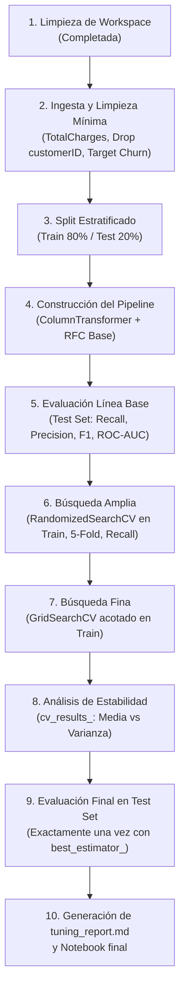

# Plan de Implementación: StreamLoop — Ajustando el Modelo de Cancelación

Este documento establece la estrategia completa de desarrollo para el proyecto de predicción y retención de cancelación (*churn*) de **StreamLoop**, cumpliendo con los requerimientos técnicos y de negocio fijados en [`strategy.md`](file:///c:/Users/balsa/streamLoop-matias-idiart-viera/strategy.md).

---

## 1. Diagnóstico del Directorio Actual y Limpieza

### Estado Inicial del Workspace
El repositorio contenía archivos heredados de una plantilla previa (asistente de inventario con API FastAPI), que generaban ruido y confusión con respecto al reto de Machine Learning de StreamLoop (`api/`, `tests/`, `docs/`, `agent.py`, `server.py`, `conversation_log.csv`, `learn.json`, `products.csv`, `TESTING.md`). 

Todos estos archivos han sido removidos para dejar el espacio de trabajo completamente limpio.

### Estructura del Directorio
```text
streamLoop-matias-idiart-viera/
├── data/                       <- Dataset oficial descargado
│   └── Telco-Customer-Churn.csv
├── notebooks/                  <- Cuaderno principal de trabajo
│   └── streamloop_churn.ipynb
├── main.py                     <- Script principal para correr todo el flujo de inicio a fin
├── tuning_report.md            <- Reporte técnico exigido para el Tech Lead
├── strategy.md                 <- Requerimientos y checklist del reto
├── implementation_plan.md      <- Este plan de implementación
└── README.md                   <- Documentación general del repositorio
```

---

## 2. Metodología de los Tres Expertos

Para diseñar una solución sólida y justificada ante el Tech Lead, el problema se aborda desde tres perspectivas especializadas:

### 🧠 Experto 1: Machine Learning & Scikit-Learn Architect
* **Arquitectura de Pipeline Estricta:**
  * **Cero Data Leakage:** La partición `train_test_split(stratify=y, test_size=0.2, random_state=42)` debe ocurrir inmediatamente tras la carga y tipificación de columnas.
  * Ninguna imputación o escalado puede aplicarse sobre el conjunto global. Toda transformación debe vivir dentro de un `ColumnTransformer` encapsulado en un `Pipeline`.
* **Tratamiento de Datos:**
  * Columnas numéricas (`tenure`, `MonthlyCharges`, `TotalCharges`): Imputación por mediana + escalado estándar (`StandardScaler`). Manejo de espacios en blanco en `TotalCharges` convirtiéndolos a `np.nan`.
  * Columnas categóricas (`Contract`, `InternetService`, `PaymentMethod`, etc.): Imputación de moda + `OneHotEncoder(handle_unknown='ignore', drop='first')`.
  * Exclusión de identificadores únicos (`customerID`).
* **Espacio de Búsqueda de Hiperparámetros:**
  * Se seleccionará un clasificador idóneo y robusto: `RandomForestClassifier`. Para RandomForest, se explorarán: `n_estimators`, `max_depth`, `min_samples_split`, `min_samples_leaf`, `max_features` y fundamentalmente `class_weight` (`'balanced'` vs `'balanced_subsample'`).
* **Estrategia de Búsqueda Escalonada:**
  1. `RandomizedSearchCV`: Muestreo aleatorio en el espacio de parámetros con validación cruzada estratificada de 5 folds.
  2. `GridSearchCV`: Refinamiento centrado en la región de mayor densidad de rendimiento.

### 💼 Experto 2: Business & Financial Decision Scientist
* **Asimetría de Costos:**
  * En una suscripción de streaming, el Costo de Adquisición de Clientes (CAC) y el Valor de Vida del Cliente (LTV) son altos.
  * **Falso Negativo (FN):** Un cliente cancela y la plataforma no hace nada $\rightarrow$ Pérdida total del LTV recurrente (pérdida económica grave).
  * **Falso Positivo (FP):** Se ofrece una promoción o mensaje de retención a un cliente que no pensaba irse $\rightarrow$ Costo marginal muy bajo (pequeño descuento o comunicación).
* **Selección Deliberada de Métrica:**
  * El *Accuracy* es engañoso: en un dataset con ~26.5% de cancelaciones, un modelo tonto que prediga "No Churn" obtendría ~73.5% de accuracy pero 0% de efectividad comercial.
  * La métrica directriz para el `scoring` en CV debe ser **`recall`** sobre la clase positiva (`Churn = Yes`).
  * Se fijará **`scoring='recall'`** como métrica de optimización principal para minimizar drásticamente los Falsos Negativos, monitoreando que la precisión no colapse a niveles inoperables.

### ⚙️ Experto 3: MLOps, Estabilidad & Reproducibilidad
* **Análisis de Varianza y Estabilidad entre Folds:**
  * No basta con mirar `mean_test_score`. Un modelo con media alta pero varianza elevada es inestable en producción.
  * Se extraerá de `cv_results_` el top de configuraciones analizando el trade-off entre `mean_test_score` y `std_test_score`.
* **Aislamiento del Test Set:**
  * Se garantiza el cumplimiento de la regla de oro: el test set solo se evaluará **dos veces en todo el ciclo de vida del proyecto**:
    1. Una vez con la **Línea Base** (hiperparámetros por defecto).
    2. Una vez con el **Modelo Final Ajustado** seleccionado tras el análisis de CV.
* **Entregables de Calidad:**
  * Notebook reproducible con celdas ejecutadas secuencialmente, gráficos explicativos y tabla comparativa.
  * `tuning_report.md` riguroso, listo para revisión ejecutiva del Tech Lead.

---

## 3. Ciclo de Auto-Refinamiento (Self-Refinement Loop)

### Iteración 1: Borrador Inicial
* **Idea:** Tomar el dataset, transformar `TotalCharges` a float, hacer One-Hot Encoding con `pd.get_dummies`, dividir en train/test, correr un `RandomForestClassifier` en `GridSearchCV` directamente.
* **Crítica Rigurosa (Red Teaming):**
  1. ❌ **Data Leakage crítico:** `pd.get_dummies` antes del split asume conocer todas las categorías y niveles del test set. Además, si hay nulos y se imputan antes de dividir, la media/mediana del test contamina el train.
  2. ❌ **Ineficiencia computacional:** Lanzar `GridSearchCV` de entrada en un espacio amplio de RandomForest explota exponencialmente en tiempo ($5 \times 4 \times 4 \times 3 \times 3 \times 5 \text{ folds} = 3,600 \text{ entrenamientos}$).
  3. ❌ **Falta de baseline:** No existía una medición formal del pipeline por defecto antes de optimizar.
  4. ❌ **Ignorar la variabilidad:** Quedarse con `grid.best_params_` sin auditar `cv_results_` ignora si el mejor fold tuvo suerte estadística.

### Iteración 2: Plan Refinado y Blindado (Definitivo)
* **Corrección 1 (Pipeline integral):** Se utiliza `ColumnTransformer` dentro de `sklearn.pipeline.Pipeline`. La imputación y codificación se calculan estrictamente dentro de cada fold de validación cruzada.
* **Corrección 2 (Estrategia coarse-to-fine):** 
  - Fase 1: `RandomizedSearchCV(n_iter=30, cv=5, scoring='recall', random_state=42, n_jobs=-1)` para muestrear el hiperespacio.
  - Fase 2: Acotar una rejilla cerrada de 18-24 combinaciones alrededor del vecindario óptimo con `GridSearchCV(cv=5, scoring='recall', n_jobs=-1)`.
* **Corrección 3 (Baseline formal):** Pipeline idéntico pero con estimador por defecto evaluado en test set y registrado formalmente en tabla comparativa.
* **Corrección 4 (Auditoría de Estabilidad):** Inspección sistemática de `mean_test_score` y `std_test_score` en `cv_results_`, documentando la justificación en `tuning_report.md`.

---

## 4. Fases de Ejecución Paso a Paso



### Detalle de Tareas:

1. **Fase 0: Preparación del Entorno y Limpieza (Completada)**
   - Eliminados archivos obsoletos.
   - Directorios `notebooks/` y `data/` creados.

2. **Fase 1: Ingesta y Preparación de Datos**
   - Cargar `Telco-Customer-Churn.csv` desde la URL oficial (y fallback local).
   - Convertir `TotalCharges` a numérico (`errors='coerce'`).
   - Mapear target `Churn`: `'Yes' -> 1`, `'No' -> 0`.
   - Eliminar `customerID`.
   - Realizar `train_test_split(X, y, test_size=0.2, random_state=42, stratify=y)`.

3. **Fase 2: Pipeline y Línea Base**
   - Definir sub-pipeline numérico: `SimpleImputer(strategy='median')` + `StandardScaler()`.
   - Definir sub-pipeline categórico: `SimpleImputer(strategy='most_frequent')` + `OneHotEncoder(handle_unknown='ignore', drop='first')`.
   - Ensamblar con `RandomForestClassifier(random_state=42)`.
   - Entrenar en `X_train` y evaluar en `X_test`.
   - Registrar métricas base: Recall, Precision, F1, ROC-AUC y matriz de confusión (FN base).

4. **Fase 3: Optimización Sistemática**
   - Configurar distribuciones para `RandomizedSearchCV`:
     - `classifier__n_estimators`: [100, 200, 300, 400]
     - `classifier__max_depth`: [4, 6, 8, 10, 15, None]
     - `classifier__min_samples_split`: [2, 5, 10, 20]
     - `classifier__min_samples_leaf`: [1, 2, 4, 8, 16]
     - `classifier__max_features`: ['sqrt', 'log2', 0.5, 0.7]
     - `classifier__class_weight`: ['balanced', 'balanced_subsample']
   - Ejecutar `RandomizedSearchCV` con `cv=StratifiedKFold(n_splits=5)`, `scoring='recall'`.
   - Analizar resultados y centrar la rejilla en `GridSearchCV` alrededor de los mejores valores.
   - Analizar tabla de `cv_results_`: trade-off entre media de recall y desviación estándar entre folds.

5. **Fase 4: Evaluación Final y Reporte**
   - Evaluar el modelo seleccionado en `X_test`.
   - Generar visualizaciones: Matriz de Confusión comparativa (Base vs Tuned), Curva ROC, Curva Precision-Recall.
   - Cuantificar el beneficio de negocio: reducción porcentual de Falsos Negativos y clientes en riesgo detectados.
   - Redactar `tuning_report.md` con la justificación técnica solicitada por el Tech Lead.

